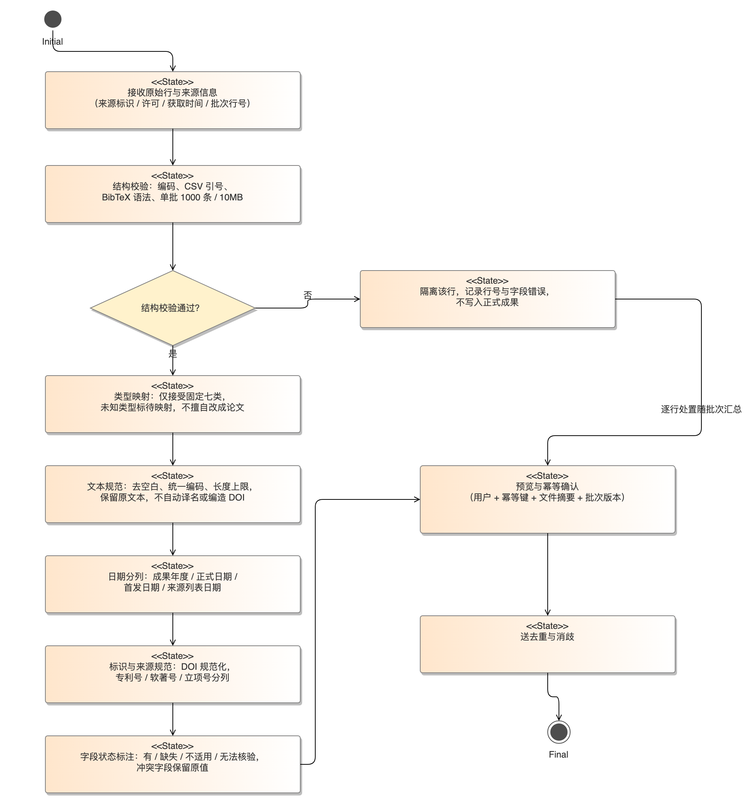
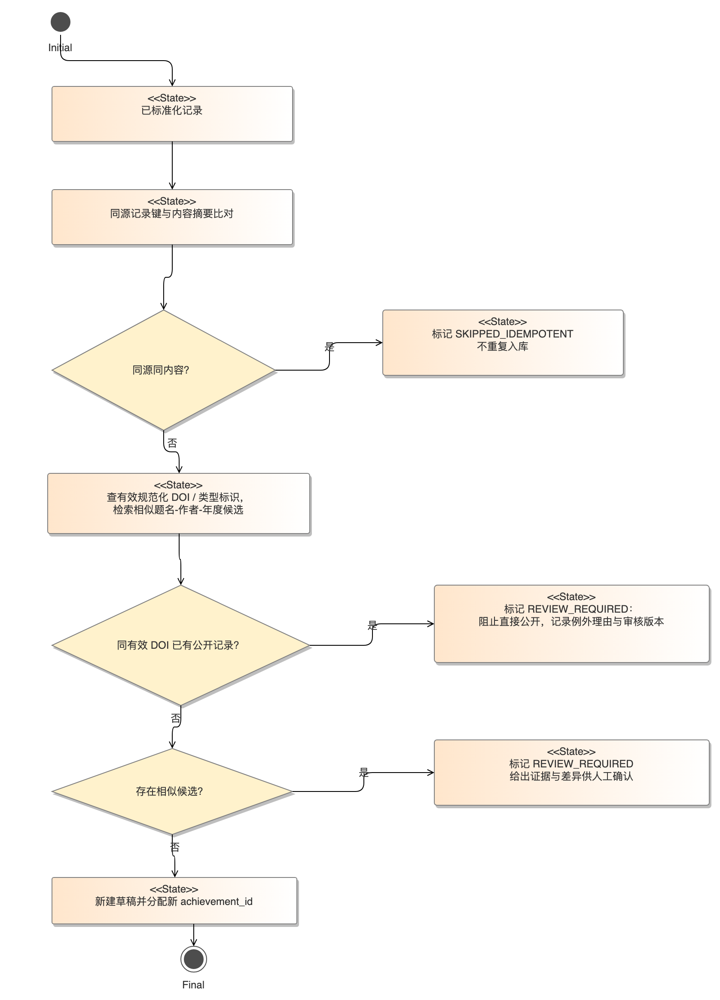
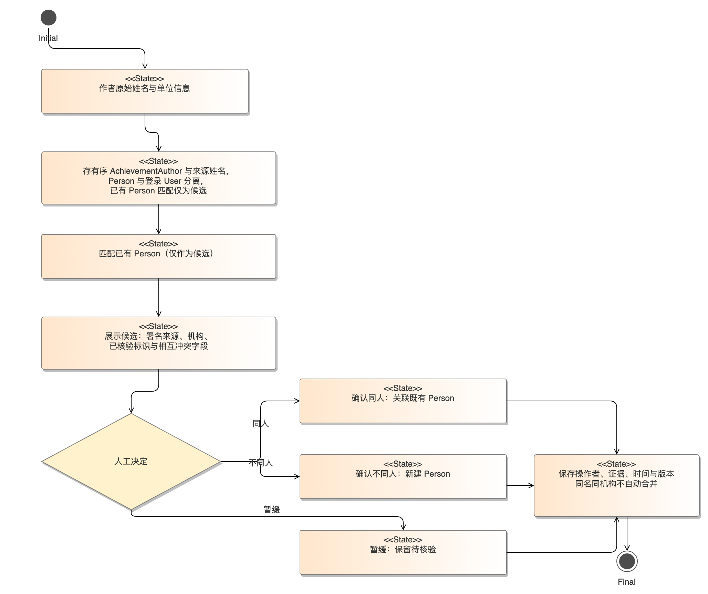
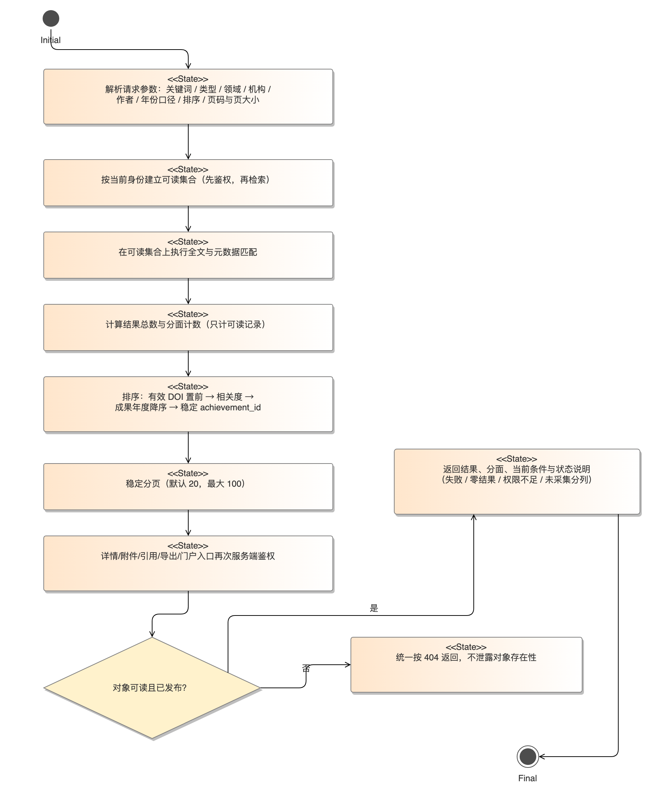

# 学术成果分享平台核心模块开发规范（SPEC）

**版本**：V1.1 提交整理版　**日期**：2026-10-13　**基线**：B1《学术成果分享平台软件需求规格说明书》V1.1、A3 六用例清单、A4/A5 详细规约。**性质**：实现约束与可执行验收设计；不表示系统已编码、测试通过或组员已签署。

## 0. 适用范围与统一约定

本 SPEC 覆盖课程要求的数据清洗、成果去重、学者消歧、检索排序，并补充 B1 首期必验的专家合作网络。采集任务的许可、调度与三次重试以 UC01、FR-25/26 为上游，门户认领审核以 UC02/03、FR-27 为上游。所有模块均以 B1 SRS 的实体、权限、版本、接口和验收口径为准；若规则冲突，先修订 SRS 并留下变更记录，再改本规范。

| 规范 | 输入与输出 | 主要追溯 |
| --- | --- | --- |
| SPEC-ETL-01 清洗与标准化 | 合法来源原始行 → 规范字段、字段状态、逐行处置 | UC01/05；FR-03/09/25/26，DR-02—04/07/09，IF-03/07/12，AT-07/14 |
| SPEC-DEDUP-01 成果去重 | 已标准化记录 → 候选/待核验/已确认关联或新记录 | UC01/05；FR-26，DR-05/07，AT-09/14 |
| SPEC-DISAMB-01 人员消歧 | 作者原始信息 → Person 候选及人工核验结论 | UC01/02/04/05；FR-05/08/18/27，DR-01/05/09，AT-09/15 |
| SPEC-SEARCH-01 检索排序与分面 | 当前请求和身份 → 有权结果、总数、分面、稳定顺序 | UC04；FR-13—18/24，IF-04/05，NFR-01/03，AT-01/03 |
| SPEC-NET-01 合作网络 | 当前身份和筛选 → 可读节点/边/最短路径 | UC06；FR-28/29，IF-13，AT-16/17 |

**共同不变量**：`achievement_id` 与 `person_id` 为平台稳定 ID。原始来源值不可被规范值覆盖。无权与不存在对象统一按 B1 接口规则处理；公开统计、搜索、导出及网络都先按同一访问规则过滤。幂等提交和版本冲突遵循 B1 5.2；时间内部 UTC、界面 UTC+8。草稿、退回、下架、删除和受限记录不得因缓存或异步索引被访客读取。

### 0.1 统一阈值与约束汇总

各节正文中的数值集中在下面一张表，便于评审取值与后续测试对齐；「性质」列区分**已确认规则**与**设计目标／未确认项**，后者不得当作已实测结果使用。

| 编号 | 项目 | 取值或规则 | 出处 | 性质 |
| --- | --- | --- | --- | --- |
| C-01 | 成果类型枚举 | 固定七类：paper／patent／software／award／project／teaching_material／manuscript；论文子类型单独保存 | FR-02、DR-01 | 已确认 |
| C-02 | 题名长度 | 1—500 字 | §1.2.3 | 已确认 |
| C-03 | 摘要长度 | 最多 20000 字 | §1.2.3 | 已确认 |
| C-04 | 关键词 | 最多 20 个，每个最多 100 字 | §1.2.3 | 已确认 |
| C-05 | 单批导入上限 | 1000 条且 10 MB（UTF-8 CSV、标准 BibTeX） | IF-03／IF-07、NFR-02 | 已确认 |
| C-06 | 导入格式 | 人工登记、UTF-8 CSV、标准 BibTeX；**知网 TXT 不解析** | IF-03、§1.1 | 已确认 |
| C-07 | 成果年度 | 人工送审必须为四位年度；合法历史导入的未知年可空并留草稿 | FR-03／09、DR-04 | 已确认 |
| C-08 | 字段状态取值 | 有／缺失／不适用／无法核验 | DR-03／09 | 已确认 |
| C-09 | 来源 URL 协议 | 限 http／https | DR-02 | 已确认 |
| C-10 | 分页 | 默认每页 20 条，最大 100 条 | IF-04、§4.1.1 | 已确认 |
| C-11 | 导出上限 | 单批最多 1000 条且 10 MB，不含附件 | FR-20、IF-10 | 已确认 |
| C-12 | 附件约束 | 单附件 ≤ 20 MB，每条 ≤ 5 个，仅 PDF／PNG／JPG／JPEG | FR-04、NFR-05 | 已确认 |
| C-13 | 采集重试上限 | 最多 3 次（**设计上限，不是实测的来源行为**） | FR-25／26 | 设计规则 |
| C-14 | 保存检索与收藏 | ≤ 50 个保存检索条件，≤ 500 条收藏 | FR-23 | 已确认 |
| C-15 | 存储时间口径 | 内部 UTC，界面 UTC+8 | SRS 5.2 | 已确认 |
| C-16 | 性能设计目标 | 4 vCPU／8 GB、20 并发、P95 ≤ 2 秒、5xx < 1%（**均为目标，未实测**） | NFR-01、AT-01 | 设计目标 |
| C-17 | 相似候选阈值 | **未确认**：候选分数只供排序，自动合并开关初版关闭，不写成已确认业务规则 | §2.1 | 未确认 |
| C-18 | 合作网络最短路径口径 | 过滤后的无向图上按边数最少；多条等长时按稳定 Person ID 顺序取一条并标注口径 | §5 | 已确认 |
| C-19 | AT-17 最小图样例 | A—B、B—C 各 1 条可读共著，A—C 无边；查询 A→C 返回 A—B—C | AT-17 | 已确认 |

> 若上表与 B1 SRS 条款冲突，以 SRS 为准并同步修订本表；C-13 与 C-16 只能作为设计与测试输入，不得写成运行测量结果。


## 1. SPEC-ETL-01 清洗与字段标准化



*图 1-1　SPEC-ETL-01 清洗与字段标准化流程（来源：CodeArts Modeling 导出；对应 FR-03／09／25／26，DR-02—04／07／09，AT-07／14）*


### 1.1 输入、输出及边界

输入为人工登记、UTF-8 CSV、标准 BibTeX 或经许可的采集任务行，连同来源标识、许可依据、获取时间、批次/行号、原始字段。CSV/BibTeX 的 1000 条和 10 MB 单批上限由 IF-03/07 与 NFR-02 在预览前检查；未定义语法的知网 TXT 不直接解析。无许可的自动采集配置在 UC01 阶段拒绝运行，不能让清洗模块补办授权。

输出为 `normalized_record`、每字段 `raw_value/normalized_value/status/provenance`、`row_result`（有效/待补/错误/跳过/待人工确认）和结构化 `field_errors`。任一行失败只隔离该行，不把整个批次伪报成功；批次分别累计新增、更新、跳过、失败。原始记录、错误及处理版本须可回放和审计。

### 1.2 处理顺序

1. **结构校验**：校验 UTF-8、CSV 引号/JSON 数组、BibTeX 基本语法、行号与单批大小。解析失败保留原行和错误代码，不写入正式成果。
2. **类型映射**：只接受 B1 固定七类 `paper/patent/software/award/project/teaching_material/manuscript`；论文子类型单独保存。未知类型标待映射，不擅自改成论文。外部字段按有版本的映射表转换。
3. **文本规范**：去首尾空白、统一可判定编码；题名 1—500 字，摘要最多 20000 字，关键词最多 20 个且每个最多 100 字。保留原文本；不自动译名、编造 DOI、机构或作者。
4. **日期与年度**：人工送审必须有四位成果年度；合法历史导入的未知年可保存为草稿空值。`publication_year`、正式日期、首发日期、来源列表日期和来源分组年度分列。不能用知网列表日期或来源分组年度静默替代成果年度；正式日期推年须留推导标识并待核。
5. **标识与来源**：DOI 去解析前缀、空白并做大小写规范，用于候选；语法合法不等于外部真实存在。专利号、软著号、立项号保存在适用的类型标识字段，不套 DOI。来源 URL 限 http/https，保留获取时间、检索条件与许可说明。
6. **字段状态**：每个适用字段标有/缺失/不适用/无法核验。DOI、关键词可缺失；页面未展示不证明原文不存在。冲突字段保留原值并建核验任务。
7. **送去重与消歧**：只对通过结构与基础校验的规范记录生成候选。模型建议只能进入建议层，人工确认后才写入正式字段。
8. **预览与确认**：返回逐行差异、可导入/待补/失败数。确认时用用户、幂等键、文件摘要和批次版本控制；同键同内容返回首结果，同键异内容 409。重复运行同一批次不得重复入库。

### 1.3 可验证样例

| 样例 | 预期结果 | 追溯 |
| --- | --- | --- |
| 历史 BibTeX 无 DOI、无年份 | 草稿可留存，DOI/年份标缺失；送审提示年份必填 | FR-03/09，AT-07 |
| 记录只有来源列表日期 2024 | `source_list_date` 保留；`publication_year` 仍未知，不默填 2024 | DR-04，AT-07 |
| 同一批次确认重试两次 | 记录数不翻倍；返回相同批次结果与逐行处置 | DR-07，AT-08/14 |
| 编码/类型映射错误 | 隔离该行并给行号、字段错误；统计失败不写成功 | FR-26，AT-14 |
| 原始字段与人工已核验字段冲突 | 原值及新来源值并存，生成差异待核，不覆盖已发布字段 | FR-26，DR-02，AT-14 |

## 2. SPEC-DEDUP-01 成果去重



*图 2-1　SPEC-DEDUP-01 成果去重流程（来源：CodeArts Modeling 导出；对应 FR-26，DR-05／07，AT-09／14）*


### 2.1 候选生成与决定

去重分两层：**确定性阻止直接重复公开**与**相似候选供人工确认**。规范化的有效 DOI 相同，是论文类强候选；相同 DOI 不能直接新建第二条公开成果，除非授权处理人记录例外理由和审核版本。不同类型的专利号/软著登记号等只在各自类型及适用范围内比较，不跨类型推断相同成果。题名、作者、年度、机构相似仅生成候选，不触发自动合并；DOI 为空或冲突时不编造唯一性。

人工确认合并时指定保留的 `achievement_id`，在事务内迁移并核对来源记录、署名顺序、附件、修订及审计。已发布记录的公开字段不因新来源自动覆盖；生成新版本待审。确认“不重复”也留证据，后续同样来源批次可跳过重复提示。撤销错误合并须通过审计记录与源记录重建关联，不删原始证据。

```text
for each normalized row:
    candidates = lookup(valid_normalized_doi, type_identifier, source_record_key)
    candidates += search_similar_title_author_year(row)  # 仅候选
    if same_source_record_key_and_same_content_digest:
        mark SKIPPED_IDEMPOTENT
    elif same_valid_doi_has_published_record:
        mark REVIEW_REQUIRED; block_direct_publication
    elif candidates:
        mark REVIEW_REQUIRED; present evidence and differences
    else:
        create draft with new achievement_id
```

候选检索算法可后续优化，但不得在本 SPEC 中把未验证的相似阈值写成已确认业务规则。候选分数只供排序；自动合并开关初版关闭。

### 2.2 验收样例

- 相同有效 DOI 的两条记录：第二条进入待核验，不能直接生成第二条公开成果；经授权例外可保留独立记录并留理由（DR-05，AT-09）。
- 题名近似但 DOI 不同，或同名作者、同年不同成果：只提示候选，不能自动合并（AT-09）。
- 已发布成果收到更新：保留原公开版，差异进入待审版本；两次处理同源同摘要只记一次（FR-26，DR-06/07，AT-14）。

## 3. SPEC-DISAMB-01 学者消歧



*图 3-1　SPEC-DISAMB-01 学者消歧流程（来源：CodeArts Modeling 导出；对应 FR-05／08／18／27，DR-01／05／09，AT-09／15）*


平台把姓名字符串、`Person` 与登录 `User` 分开。导入作者先存有序 `AchievementAuthor` 和来源姓名；已有 Person 匹配仅为候选。姓名和单位相同、校内工号未核验，均不能自动合并两人；外部作者没有账号仍可作为 Person。经验证的 ORCID 或已审核的账号与 Person 关联可作为人工核验依据，不能仅凭录入的 ORCID 字符串授予权限。

消歧界面至少展示候选人的署名来源、机构、已核验标识和相互冲突字段；授权处理人可确认同人、不同人或暂缓。任何决定保存操作者、证据、时间和版本。本人认领申请 `ClaimApplication` 审核前不建立具有管理权的 User—Person 关联；多人合著分别认领各自 Person，不获得整条成果独占权。争议导致的错误关联按 FR-27 标 `disputed` 并撤销权限，保留历史与审核依据。

**验收**：同名同机构两人不会自动合并；未注册共同作者仍可登记；伪同名申请审核前无门户管理权；批准、拒绝、补证与争议撤销的权限和审计符合 AT-09/15。

## 4. SPEC-SEARCH-01 检索排序与分面



*图 4-1　SPEC-SEARCH-01 检索排序与分面流程（来源：CodeArts Modeling 导出；对应 FR-13—18／24，IF-04／05，NFR-01／03，AT-01／03）*


### 4.1 查询管线

1. 解析请求参数：关键词、类型、领域、机构、作者、年份口径、排序、页码和页大小。默认页大小 20，最大 100；不同维度 AND、同维度多选 OR，默认年度为 `publication_year`。切换来源分组年度须指定来源；未知年份单列。
2. 在服务端以当前身份、所属机构、成果状态、可见范围与获准版本建立**可读集合**，然后执行全文/元数据匹配。匿名只读已发布 public；members 限同机构认证成员；private/草稿依 B1 权限矩阵。后台角色不能越权读不属于职责的对象。
3. 在可读集合上计算结果总数与分面计数，再排序、稳定分页。索引中的旧公开副本必须再经当前权限与版本校验，收窄/下架即时撤销；缓存键包含身份/机构/权限版本及筛选口径。
4. 有效 DOI 精确匹配的可读成果置前。其他结果按相关度降序；同分按成果年度降序、`achievement_id` 稳定排序。若用户选年度排序，未知年置于有年项后；选已知被引排序时，unknown 不是 0，置于已知项后。引用数只显示有来源的可用值。
5. 详情、附件、引用、导出和门户入口再次服务端鉴权，不因结果页出现过该 ID 就放行。对象不可见与不存在统一 404。查询错误、明确零结果、权限不足与尚未采集分别呈现，不把服务故障伪装成 0 条。

### 4.2 排序与安全验收

| 输入条件 | 期望 | 追溯 |
| --- | --- | --- |
| `type=[paper,patent]` 且 `year=[2023,2024]` | 类型内部 OR、年份内部 OR，两维 AND | FR-14，AT-03 |
| public 与 private 各一条命中同一词 | 访客总数及分面均只计 public；猜 private ID 返回 404 | FR-17，AT-03 |
| 相关度同分且年份同值 | 按 ID 稳定顺序，多次翻页无随机跳动 | FR-15 |
| 被引数为 unknown 与已知 0 | unknown 在已知值后，不把未知解释成 0 | FR-15 |
| 已发布条目下架但索引未刷新 | 搜索、详情、附件和导出均即时不可读 | FR-17，DR-06，AT-10 |
| 10000 条元数据、规定混合负载 | 按 NFR-01 的 4vCPU/8GB、20 并发、预热/时长和样本量测 P95 ≤2秒、5xx <1% | AT-01；仅为目标，未实测 |

## 5. SPEC-NET-01 专家合作网络与统计口径

UC06 的统计先过滤调用者可读的已发布成果，再按 `achievement_id` 去重。多机构合作成果在各相关机构可各计 1 条，平台总数不能直接累加机构数。年份默认为成果年度，未知单列；每个统计图表显示范围、时间、来源、去重方式和生成时间。无可用数据标“无数据”，不称全网科研评价（FR-28，AT-16）。

合作网络使用同一可读集合，节点为可公开 Person，边为两人共同署名成果，边权是去重后的共同成果数。领域、机构、年度筛选同时作用于边和最短路径；节点/边点击只返回当前用户有权查看的支撑成果。最短路径在过滤后的无向图上按边数最少计算，若多条同长路径可按稳定 Person ID 顺序选一条并标注算法口径；无连接返回“当前条件下无路径”，计算失败返回错误，不推断现实中从未合作。Person 同名未核验不得自动并点，引用关系不能当作合作边（DR-09）。

**AT-17 最小图样例**：A—B 与 B—C 各有 1 条可读共著成果，A—C 无边，查询 A 到 C 返回 A—B—C，节点/边均可打开证据；按年度过滤掉 B—C 后明确无路径。若 B—C 支撑成果改为 private，访客看到的边权、路径、统计及导出均不含它。路径计算时间上限和图规模上限需在实现设计阶段配置并纳入压测，不在缺少基准数据时虚构已达成数值。

## 6. 评审与交付检查

| 检查项 | 当前状态 |
| --- | --- |
| 清洗、去重、消歧、检索排序、统计网络的规则均能追溯到 B1 FR/DR/IF/AT | 文档已覆盖，待 A1/B1 人工复核 |
| 七类类型、权限、版本、未知字段和三次重试口径与 B1 一致 | 文本已核对；实现和测试未开始 |
| AT-07/09/14/16/17 样例可作为后续测试输入 | 已给出判据；尚无执行结果 |
| 与 B 组故事、SRS、A 组六份用例规约的终版签署 | 待组内合稿评审 |

### 6.1 规范评审记录

任务书要求「规范评审记录存档」。以下逐条记录评审结论与遗留项；**未发生的评审不预先填写**。

| 序号 | 评审对象 | 评审人 | 评审日期 | 结论 | 遗留项与处理 |
| --- | --- | --- | --- | --- | --- |
| R-01 | SPEC 全篇（清洗／去重／消歧／检索排序／合作网络）与 B1 SRS 条款一致性 | 待填 | 待填 | 待评 | — |
| R-02 | 统一阈值与约束汇总（§0.1）逐项与上游条款核对 | 待填 | 待填 | 待评 | — |
| R-03 | 规范—代码对应关系表（§7）与实际实现范围核对 | 待填 | 待填 | 待评 | 实现未开始，评审在功能实现阶段进行 |
| R-04 | 接口契约与错误码（§8）与构件设计的 OpenAPI 对齐 | 待填 | 待填 | 待评 | — |

**AI 使用记录**：本合稿由 Codex 根据本仓库 B1 SRS 与 A 组 UC 规约起草、整理和交叉核对；图像由本地脚本生成。所有阈值与业务规则以 B1 已写明条款为准；待人工评审的内容已标出。参考目录中的独立设计文档仅作结构参考，不作为本组已完成访谈、实现或测试的证据。

## 7. 规范—代码对应关系表（交付证据）

任务书把「规范—代码对应关系表」列为 SPEC 的交付证据。本表把每条规范条款映射到**计划实现单元**与验收入口，落实「规范先行、代码履约」：代码未提交时不填实现状态为已实现，也不把未写入规范的逻辑当作已受规范约束。

**说明**：模块与函数名为**建议命名**，最终以构件设计阶段的分层与命名约定为准；「实现状态」在本阶段一律为「待实现」。

| 规范条款 | 计划实现单元（建议命名） | 上游需求 | 验收用例 | 实现状态 |
| --- | --- | --- | --- | --- |
| §1.2.1 结构校验 | `etl.validate_structure` | FR-03／26、IF-03／07 | AT-07／14 | 待实现 |
| §1.2.2 类型映射 | `etl.map_type` | FR-02、DR-01 | AT-14 | 待实现 |
| §1.2.3 文本规范 | `etl.normalize_text` | FR-03 | AT-07 | 待实现 |
| §1.2.4 日期与年度 | `etl.normalize_date` | DR-04 | AT-07 | 待实现 |
| §1.2.5 标识与来源 | `etl.normalize_identifier` | DR-02／03 | AT-07 | 待实现 |
| §1.2.6 字段状态 | `etl.mark_field_status` | DR-03／09 | AT-07 | 待实现 |
| §1.2.7 送去重与消歧 | `pipeline.dispatch` | FR-26 | AT-14 | 待实现 |
| §1.2.8 预览与幂等确认 | `etl.preview_commit` | DR-07、NFR-02 | AT-08／14 | 待实现 |
| §2.1 去重候选生成与决定 | `dedup.find_candidates`、`dedup.decide` | FR-26、DR-05／07 | AT-09／14 | 待实现 |
| §3 消歧匹配与人工核验 | `disamb.match_person`、`disamb.review` | FR-05／08／18／27、DR-09 | AT-09／15 | 待实现 |
| §4.1.1 检索参数解析 | `search.parse_query` | FR-13／14／15、IF-04 | AT-03 | 待实现 |
| §4.1.2 可读集合（先鉴权） | `search.visible_set` | FR-17、NFR-03 | AT-03／10 | 待实现 |
| §4.1.3 总数与分面 | `search.facets` | FR-14 | AT-03 | 待实现 |
| §4.1.4 排序与稳定分页 | `search.rank`、`search.paginate` | FR-15 | AT-03 | 待实现 |
| §4.1.5 详情／附件／导出再鉴权 | `search.authorize_object` | FR-17／20、IF-10 | AT-10／11 | 待实现 |
| §5 统计口径与去重计数 | `stats.aggregate` | FR-28、DR-04 | AT-16 | 待实现 |
| §5 合作网络与最短路径 | `net.build_graph`、`net.shortest_path` | FR-29 | AT-17 | 待实现 |
| §0.1 统一阈值与约束 | 配置项 `config/thresholds` | — | 各项 AT | 待实现 |

**维护规则**：新增或修改规范条款时同步更新本表；实现提交时应把「实现状态」改为已实现并附代码路径与测试路径，未附路径的不得改状态。

## 8. 接口契约与错误码（建议稿）

任务书把 OpenAPI 文档归入**构件设计**阶段，因此本节只给出各核心模块**对外的输入、输出、错误与幂等约定**，作为规范的「怎么做（接口）」部分；正式接口定义以构件设计的 OpenAPI 为准，两者不一致时以 OpenAPI 为准并回改本节。

*表 8-1　核心模块接口契约（建议稿）*

| 接口 | 输入 | 输出 | 错误 | 幂等 |
| --- | --- | --- | --- | --- |
| `POST /imports/{batch_id}/commit` | 用户、幂等键、文件摘要、批次版本 | 逐行处置结果与新增／更新／跳过／失败计数 | 409（同键异内容）、422（结构或类型映射失败） | 是：同键同内容返回首结果，不重复入库 |
| `GET /achievements` | 关键词、类型、领域、机构、作者、年份口径、排序、页码、页大小 | 可读结果、总数、分面、条件回显 | 400（条件或页大小非法）、404（对象无权或不存在，统一响应） | 只读 |
| `GET /achievements/{id}` | 稳定 `achievement_id`、调用者身份 | 获准版本、类型专属字段、来源与核验状态 | 404（无权或不存在） | 只读 |
| `GET /achievements/{id}/attachments/{aid}` | 成果与附件标识、调用者身份 | 已授权且通过安全检查的附件 | 403（有权读元数据但无权下载）、404 | 只读 |
| `POST /exports` | 选中项、格式（CSV／BibTeX）、当前发布版本 | 实际导出条数与格式；≤ 1000 条且 ≤ 10 MB | 413（超限）、207（部分项无权，逐项说明） | 是：同参数同版本返回一致内容 |
| `POST /collect/tasks` | 来源标识、检索范围、成果类型、执行方式、更新规则 | 任务编号、状态 `queued`、配置快照 | 403（无权限）、422（来源未获许可或配置不合法） | 是：同配置不重复建任务 |
| `POST /collect/tasks/{id}/retry` | 任务编号、重试原因 | 状态转 `retrying`，记录次数与原因 | 409（已达 3 次上限或状态不允许重试） | 是 |
| `POST /collect/tasks/{id}/stop` | 任务编号 | 状态转 `stopped`，记录停止人与已处理数 | 409（任务已终态） | 是 |
| `POST /claims` | 申请人标识、目标门户标识、佐证材料引用 | 申请编号、状态 `submitted` | 409（同一申请人对同一门户已有未完结申请）、422（必填或格式不符） | 是：重复提交返回原申请编号 |
| `POST /claims/{id}/decide` | 申请编号、决定（通过／驳回）、理由与依据 | 状态 `approved`／`rejected`，审核人、时间与日志 | 403（无审核权限）、409（已被并发处理或状态不允许决定） | 否：同一申请只允许一次有效终局决定 |
| `GET /stats/summary` | 机构、领域、年份、类型筛选 | 可读已发布成果的统计与口径说明（范围、时间、去重方式、生成时间） | 400（筛选非法） | 只读 |
| `GET /net/graph`、`GET /net/path` | 筛选条件、起止节点 | 可读节点与边、边权、最短路径与支撑成果；无连接时返回“当前条件下无路径” | 400、404（节点不可读） | 只读 |

**共同约定**：对象级无权与不存在统一按 404 处理，不泄露记录存在性；公开统计、检索、导出与网络先按同一访问规则过滤；查询失败、明确零结果、权限不足与尚未采集分别呈现，不把服务故障伪装成 0 条。

