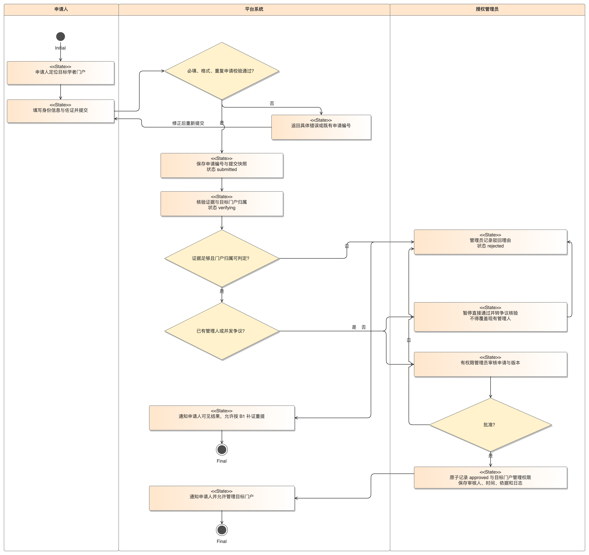
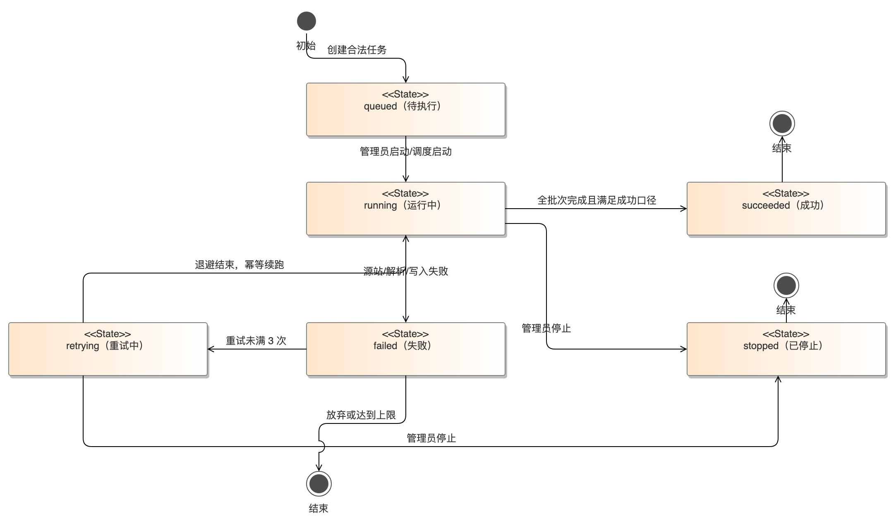
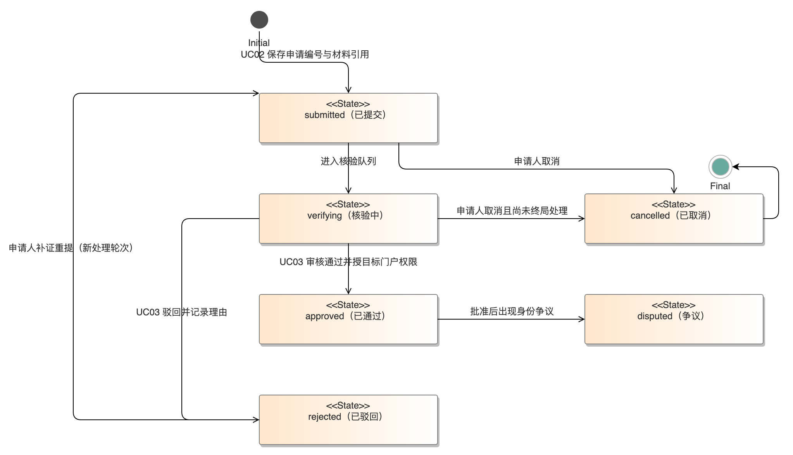
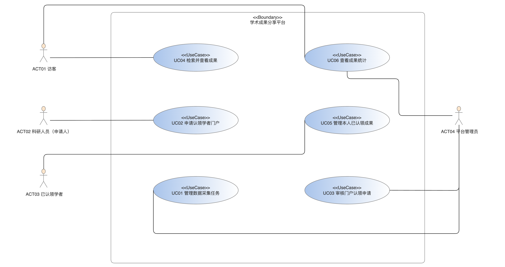

# 学术成果分享平台软件需求规格说明书

版本：V1.1 团队合稿修订版

编制：B1主笔整合，输入来自B2、B3、B4、B5现有提交材料

日期：2026-10-13

交付对象：课程教师与项目组，用于作业2需求建模

本说明书规定平台范围、参与者、功能、质量指标、接口、数据和验收要求。文档是需求建模交付稿，不表示软件已实现、测试已通过或全员已签署评审。现有成员稿中的冲突在本版采用单一规则；原稿保留，修订依据见附录A。A组用例图、用例规约和追溯矩阵作为配套交付，分别查阅，不在本文件中重复编排。

## 1 范围与编写依据

### 1.1 平台目标

平台面向科研从业人员和普通用户，集中管理论文、专利、软件著作权、获奖、科研项目、课程材料及未发表手稿，提供合法来源采集、清洗去重、分类检索、科研人员门户、身份认领审核、成果维护与统计分析。机构作为分类和权限属性，不将服务范围限定为某一所学校。首期验收使用一个演示机构范围，数据结构支持多个机构。

### 1.2 本期范围

本期必须覆盖任务书规定的数据采集与更新、学术领域分类与过滤、学者门户与审核认领、科研人员与成果检索、统计分析，以及至少1项创新功能。人工登记和合法元数据导入构成同一条入库路径，不能用仅有上传页面替代数据处理链。必验创新采用专家合作网络的交互筛选和合作路径展示，见FR-29。

作业1需求调研实际核验了论文、专利、项目、获奖四类公开样本；本作业按七类成果设计数据模型与操作能力。七类是系统范围和验收要求，不表示已取得每类真实样本，也不表示每类都允许自动采集。未发表手稿只可由有权用户按审核与可见范围规则登记，不能作为公开网页采集对象。专家合作网络属于本期设计选定的必验创新，尚无目标用户访谈支持其使用偏好。

B2/B3的24条故事保留原编号，补齐专利类型、门户认领与数据采集等任务书要求。原故事分级Must/Should/Could保留；任务书直接要求不能因原故事写为Should而省略。Could的订阅与收藏属于可选增强，不作为首期必验的替代。

不纳入本期：有偿成果转让、付费全文下载、专利交易、未授权收费库抓取、共用外部账号、任意知网TXT自动解析、全网实时引用覆盖和扫描件OCR。来源公开不自动等于许可采集；采集任务须记录使用条件与授权依据。

### 1.3 引用材料与证据边界

| 编号 | 材料 | 用途与边界 |
|---|---|---|
| SRC-TASK | 课程实践任务书 学术成果分享平台 v1 | 课程必做功能、数据规模和最终链路演示的直接依据 |
| SRC-PLAN | 作业1与作业2分工及交付物规划 | B1主笔、B2/B3故事、B4专项章节、B5验收复核的分工依据 |
| SRC-B1 | B1竞品矩阵及复核记录 2026-10-12 | 国内4类渠道与国际3平台比较，保留未实测和无法确认的边界 |
| SRC-B2 | US-01至US-12 原稿 | 上传与管理链的故事和初始业务规则 |
| SRC-B3 | US-13至US-24 原稿 | 检索与引用链的故事和初始业务规则 |
| SRC-B4 | B4存量数据、20条抽样及SRS专项章节 | 浙大计算机学院名称在知网2021至2025年度范围检得456条；样本DOI页面字段缺失13/20，关键词缺失1/20。性能数值是设计验收目标，不是测量结果 |
| SRC-B5 | 推演、反方评审和验收标准复核 | 教师/管理员需求为推演；AI处置建议不等于真实访谈或已完成人工裁定 |
| SRC-A1 | 作业1需求调研报告V1.1及补充实测记录，2026-10-13 | 四类公开成果样本、五条论文开放源请求、领域试标与逐源合规边界；不证明七类均有真实数据，也不替代教师和管理员访谈 |
| SRC-A3 | A3系统边界与UC01—UC06用例清单、A1追溯矩阵 | 六个系统用例与FR、AT的关联；用例清单是配套模型，功能范围仍以本SRS为准 |

北航渠道比较与浙大机构样本是不同对象，两者分别引用，不合成同一学院的事实。某库未检得某类型不能推导该机构没有该类成果；样本页面未显示DOI不证明原文没有DOI。OpenAlex和DBLP的五条已知论文小样本只验证了本轮接口可得性，不推断总体召回率。教师和管理员尚无真实访谈；其管理偏好与机构审核制度仍待验证。后续团队统一结论如有变更，按版本变更记录处理。

### 1.4 术语与编号

SRS表示系统需求规格说明书；FR表示功能需求，NFR表示非功能需求，IF表示接口，DR表示数据规则，AT表示专项验收场景。US保留US-01至US-24，故事验收编号采用AC-US-xx-yy。ID指平台稳定标识，DOI与ORCID只在适用并有合法来源时保存，不取代内部主键。A3用例清单采用UC01—UC06，A1追溯矩阵把用例与本SRS的FR、AT对应；本SRS引用这些编号时以配套清单为准。

## 2 总体描述

### 2.1 参与者与权限

| 参与者 | 允许的职责 | 限制 |
|---|---|---|
| 访客 | 搜索和查看已发布公开成果、公开学者门户、获授权附件、引用和公开统计 | 不读草稿、院内/私有记录、人员私密字段或受限附件 |
| 认证成员 | 学生、教师及其他科研人员；登记、导入、申请认领、管理有权成果 | 认证身份不自动获得审核、账号管理或他人成果编辑权 |
| 初审教师 | 对分派且署名相关的学生成果提出初审意见 | 初审不等同发布；本人提交不得本人初审，意见绑定版本 |
| 平台管理员 | 按单独授予的权限终审、认领审核、争议与下架、采集和数据治理 | 账号维护权限不自动赋予终审；本人提交或有利益冲突时须转其他授权人 |
| 外部数据源 | 提供公开或获许可的元数据、来源标识与更新信息 | 不作为自动授权、事实完整性或全文下载许可的证明 |

共同作者Person与登录User分别建模。未注册作者仍可登记，只有经审核的身份关联才能授予本人管理权限。个人作者关系可多对多，不能把多人合著成果的认领变成一人独占。

### 2.2 流程与状态

人工成果：draft草稿 → pending_initial待初审（适用时） → pending_final待复审 → published已发布；任何审核退回进入returned。没有合格署名初审教师或为教师本人提交时，直接pending_final；终审必须由非提交者且无冲突的授权管理员完成。待审撤回返回draft；已发布下架进入withdrawn，删除确认进入deleted。draft与returned仅责任人和授权处理者可读，不能因可见范围public而直接被检索。

已发布内容的修改创建新草稿版本，所有公开字段、附件、署名或范围放宽都重审；原发布版继续按原权限展示。收窄范围或隔离下架即时生效。教师任一合格意见通过可进入终审，但其他教师没有操作时保持未操作，并通知全员；全部拒绝才退回。状态变更以版本号校验，拒绝旧版本审核与重复写入。

认领申请：submitted → verifying → approved/rejected；用户可cancelled，管理员可将批准后争议身份标为disputed并撤销错误关联。采集任务：queued → running → succeeded/failed；failed可进入retrying再执行，stopped表示已停止；重试次数、错误原因和执行批次须留痕，重试不重复创建数据。

*图 2-1　认领审核活动图（来源：CodeArts Modeling 导出；对应 UC02／UC03、FR-27、IF-11、AT-15）*

*图 2-2　采集任务状态图（来源：CodeArts Modeling 导出；对应 UC01、FR-25／26、IF-12、AT-13／14）*

*图 2-3　认领申请状态图（来源：CodeArts Modeling 导出；对应 UC02／UC03、FR-27、AT-15）*

### 2.3 运行与验收基准

工程实现使用课程指定CodeArts环境，业务框架和部署选型由后续设计决定。容量验收库至少10000条真实公开或明确标记模拟的成果元数据，不将B4的456条样本当作系统全部数据。性能目标采用B4设计目标，测试基准为4 vCPU、8GB内存、单实例业务服务与数据库/索引服务同一测试网络；测试报告记录实际配置，变更配置需同时记录原因与重测结果。100个有效会话、20个并发请求不等于宣称有相应真实活跃用户。

## 3 功能需求

本章按**功能需求的来源**分为两节，而不是按功能主题分组；FR 编号在整章内连续（FR-01—FR-29），跨文档引用一律使用 FR 编号，不受小节归属影响。

- **3.1 来自用户故事的功能需求（FR-01—FR-24）**：由 B2/B3 的 24 条用户故事逐条对应而来，每条 FR 与同编号 US 一一对应，业务规则与验收条件存于故事文件。
- **3.2 任务书必做但故事未覆盖的功能需求（FR-25—FR-29）**：课程任务书要求、而 24 条故事未覆盖的能力（合法采集任务、清洗入库与增量更新、科研人员门户与身份认领、分类与统计分析、专家合作网络交互展示），按任务书补为 FR-25—FR-29，并配 AT-13—AT-17。**不新增用户故事凑数**，也不因为原故事未写而降低为可选项。

> 分节依据见附录 A「整合取舍与版本历史」中「统计及采集在故事中覆盖不足」一行。

### 3.1 来自用户故事的功能需求（FR-01—FR-24）

以下条目与同编号US一一对应，业务规则及100条Given/When/Then验收条件存于故事文件；任务书必做补全项见 3.2。

*图 3-1　系统用例图（来源：CodeArts Modeling 导出；参与者与 UC01—UC06 的角色对应见 2.1 节）*

#### FR-01 上传学术成果

系统应支持学生或教师等认证成员提交自己的学术成果。先保存草稿再提交；只有通过服务端校验且附件完成安全检查的版本可送审。有符合条件的署名教师时进入初审，否则直接进入管理员复审；未审核记录不公开。

来源：负责人分工中的上传管理链；B2原稿；任务书成果维护要求。 故事：US-01；故事优先级：Must；验收：AC-US-01-01至AC-US-01-04。

#### FR-02 成果类型登记

系统应支持认证成员按不同成果类型登记。一级类型固定为论文、专利、软件著作权、获奖、项目、课程材料、未发表手稿共7类；论文另有期刊/会议/学位论文子类型。管理员维护展示顺序和分类，不允许普通用户自造类型。七类是登记和展示能力；作业1公开来源只核验了论文、专利、项目、获奖四类，未发表手稿不接入公开采集任务。

来源：任务书明确列举论文、专利、项目、获奖；B2原稿另含软件著作权、课程材料、未发表手稿。 故事：US-02；故事优先级：Must；验收：AC-US-02-01至AC-US-02-04。

#### FR-03 元数据校验

系统应支持认证成员获得字段校验和缺失提示。人工提交必填题名、至少1位作者、类型和四位成果年度；来源导入的历史年份未知时可入草稿，但不可提交公开审核。DOI及关键词可空；前后端双重校验以服务端为准。

来源：B4的20条样本记录支持DOI和关键词缺失状态；只说明该样本页面字段，不外推全部成果。 故事：US-03；故事优先级：Must；验收：AC-US-03-01至AC-US-03-04。

#### FR-04 附件与佐证材料

系统应支持认证成员上传附件并设置授权。仅接收PDF、PNG、JPG/JPEG；单文件不超过20MB，每条成果最多5个。ZIP及可执行文件不接收。实际类型与扩展名均检查；隔离检查失败的文件不能下载或全文索引。附件范围不得宽于成果。

来源：B2 US-04与B4 NFR-05、IF-08，冲突统一记录在SRS附录。 故事：US-04；故事优先级：Must；验收：AC-US-04-01至AC-US-04-04。

#### FR-05 共同作者与署名

系统应支持认证成员登记共同作者和署名顺序。Person与User分离；外部作者无需账号。登记至少1位作者，保存署名顺序、机构和通讯作者标识；同名不自动绑定身份。

来源：B2原稿；B5通讯作者验收补充；B4 DR-01。 故事：US-05；故事优先级：Must；验收：AC-US-05-01至AC-US-05-05。

#### FR-06 教师初审

系统应支持具有初审权限的教师审核相关署名成果。初审绑定提交版本。任何一位合格署名教师通过可进入管理员复审；所有初审人及提交者获通知，未操作者不能显示为已通过。全部拒绝才退回；无合格初审教师则直接管理员复审。初审意见不是最终发布许可。

来源：B5 T-01角色推演及反方意见；属于推演，不冒称真实访谈。 故事：US-06；故事优先级：Must；验收：AC-US-06-01至AC-US-06-05。

#### FR-07 管理员复审与下架

系统应支持具有终审权限的平台管理员复审并发布或下架成果。终审人与提交者不得相同；当署名或利益冲突时转另一授权管理员。退回必须有理由，重新提交重新初审；恢复下架需复审和记录原因。

来源：B5 M-01推演、B2原稿；B5退回验收补充。 故事：US-07；故事优先级：Must；验收：AC-US-07-01至AC-US-07-05。

#### FR-08 成果作者关联认领

系统应支持学生或教师等认证科研人员申请认领代录成果中的本人作者身份。自动姓名匹配只生成候选，不自动授予控制权。认领的是作者Person身份而非整条成果独占权；多人合著可分别认领本人。机构/认证证据与管理员审核通过后才生效；门户认领另见FR-27。

来源：B2原稿、B5争议推演；任务书明确要求身份认领审核。 故事：US-08；故事优先级：Should；验收：AC-US-08-01至AC-US-08-04。

#### FR-09 批量导入成果

系统应支持教师或授权导入成员预览并批量登记合法来源元数据。首版接收UTF-8 CSV模板和标准BibTeX .bib，不接收未定义语法的知网 .txt。单次1000条、10MB；先预览后确认。历史未知年度留草稿，待补后送审；不得自动发布或自动覆盖。

来源：B2 US-09、B4 IF-03/07与NFR-02；不依赖收费库自动爬取。 故事：US-09；故事优先级：Should；验收：AC-US-09-01至AC-US-09-05。

#### FR-10 已发布成果版本更新

系统应支持有编辑权的认证成员修正已发布信息。公开内容、附件、署名、可见范围放宽的修改均产生新草稿版本并重审；不原地覆盖已发布版本。收窄范围立即生效不需等待，版本留痕。旧版在新版本通过前保持原范围可读，紧急下架除外。

来源：B2 US-10与B4 NFR-03、DR-06。 故事：US-10；故事优先级：Should；验收：AC-US-10-01至AC-US-10-04。

#### FR-11 撤回与删除申请

系统应支持成果提交者撤回待审稿或申请移除已发布内容。待审可撤回为草稿并关闭任务；公开记录删除申请即进入临时隔离，不继续公开敏感内容，授权管理员确认后逻辑删除。物理清理由保留策略管理，不自动删除审计。

来源：B2 US-11；B4 DR-08。 故事：US-11；故事优先级：Should；验收：AC-US-11-01至AC-US-11-04。

#### FR-12 成果可见范围

系统应支持认证成员设置公开、仅院内或仅自己。public、members、private固定3档；members限所属机构已认证成员；private限提交责任人及为处理该记录而获授权审核人，不因共同署名自动授予读取权。草稿与退回不因设置public而公开。

来源：B2 US-12与B4数据权限规则；未发表保密诉求是设计推演。 故事：US-12；故事优先级：Must；验收：AC-US-12-01至AC-US-12-04。

#### FR-13 跨类型统一检索

系统应支持访客或认证成员使用关键词搜索全部可读成果。标题、作者、关键词、摘要及适用编号参与检索，包含7类成果。先权限过滤再计算总数/分面；有效DOI精确匹配置前，不承诺未去重数据唯一。

来源：任务书检索查看；B1矩阵公开渠道比较，结论以复核边界为限。 故事：US-13；故事优先级：Must；验收：AC-US-13-01至AC-US-13-04。

#### FR-14 组合筛选与高级检索

系统应支持访客或认证成员组合作者、机构、年份和类型条件。不同维度用AND，同一维度多选用OR。默认成果年度publication_year；来源分组年度需指定来源，未知年份单列。不得把知网列表日期替代出版年。

来源：任务书分类过滤；B3原稿。 故事：US-14；故事优先级：Must；验收：AC-US-14-01至AC-US-14-04。

#### FR-15 排序与分页

系统应支持访客或认证成员按相关度、年度或已知被引数排序。默认相关度降序；同分用成果年度降序和ID稳定排序。默认每页20，最大100；无引用数据为unknown不是0，不参与已知被引高低比较，置于已知项后。

来源：B3原稿；排序方式为设计规则，被引数只基于有来源的可用数据。 故事：US-15；故事优先级：Should；验收：AC-US-15-01至AC-US-15-04。

#### FR-16 成果详情

系统应支持访客或认证成员查看完整元数据及许可附件。展示获准版本、署名、来源、日期口径及可读附件；元数据读取权不自动授予附件下载权。已撤回、删除或不可见均返回统一404。

来源：任务书成果展示；B3 US-16与B4 IF-05。 故事：US-16；故事优先级：Must；验收：AC-US-16-01至AC-US-16-04。

#### FR-17 全链路权限一致

系统应支持平台管理员让可见范围在各入口一致。检索、分面、详情、附件、引用、导出、统计、门户、全文和通知统一鉴权；收窄和下架即时撤销读取，不等待异步索引或浏览器缓存。

来源：B3 US-17；B4 NFR-03/11。 故事：US-17；故事优先级：Must；验收：AC-US-17-01至AC-US-17-04。

#### FR-18 作者聚合与姓名消歧

系统应支持访客或认证成员查看正确作者的成果。按Person稳定ID聚合；经验证ORCID与已审核账号关联可协助识别，姓名+单位只生成候选；未经核验的工号不得成为自动合并依据。

来源：任务书门户；B3 ORCID比较及B4人员数据结构。 故事：US-18；故事优先级：Should；验收：AC-US-18-01至AC-US-18-04。

#### FR-19 引用格式与复制

系统应支持访客或认证成员生成可复制引用文本。论文支持组员指定的GB/T 7714-2015模板和BibTeX，并以人工核对的模板样例验收；不宣称对每种类型均完成正式标准认证。专利/软著等生成带类型名称及适用编号的成果引用文本，不把软著误标成专利或软件出版物。

来源：B3 US-19；B4导出要求。 故事：US-19；故事优先级：Must；验收：AC-US-19-01至AC-US-19-04。

#### FR-20 批量导出

系统应支持有读取权的用户导出选中成果或全部筛选结果。输出UTF-8 CSV或BibTeX，单次最多1000条，不导出附件。按调用时权限与当前发布版本筛选；仅统计有权对象，缺失字段不填虚构占位值。

来源：B3原稿与B4 IF-10；单次上限以整合规则统一。 故事：US-20；故事优先级：Must；验收：AC-US-20-01至AC-US-20-04。

#### FR-21 引用链与来源

系统应支持访客或认证成员查看可核验的施引和被引关系。引用边必须来自明确的参考文献关系或授权引用文件；A自己的DOI不是A引用B的证据。同名比对仅产生待核验候选，不直接形成确定引用边。首版不实时同步收费库或Google Scholar。

来源：B3 US-21；范围为平台内/授权文件记录，不保证全网覆盖。 故事：US-21；故事优先级：Should；验收：AC-US-21-01至AC-US-21-04。

#### FR-22 订阅与引用提醒

系统应支持认证成员订阅条件或本人成果引用变动。可选功能；如启用默认每日摘要，只发送新发生且订阅者有权读取的事件，取消订阅立即生效；数据中断后不补发历史积压事件，不承诺全网即时提醒。

来源：B3 Could故事及教师需求推演；可选增强不作为首版必验。 故事：US-22；故事优先级：Could；验收：AC-US-22-01至AC-US-22-04。

#### FR-23 保存检索与收藏

系统应支持认证成员保存检索条件和收藏成果。可选增强。每账号最多50个保存检索条件、500条收藏；数据私有，不用于公开排序。保存条件复现按当前数据与权限执行，不承诺结果快照完全相同。

来源：B3 Could故事；个人数据规则来自B4建议。 故事：US-23；故事优先级：Could；验收：AC-US-23-01至AC-US-23-04。

#### FR-24 许可附件全文检索

系统应支持访客或认证成员检索有权读取的PDF正文。首版支持已发布且通过安全检查的有文本层PDF；扫描件不做OCR，不提供来自不可读附件的片段。private草稿仅在所有者私人工作区可查，不进入公共搜索。

来源：B3 US-24及B4安全、权限约束。 故事：US-24；故事优先级：Should；验收：AC-US-24-01至AC-US-24-04。

### 3.2 任务书必做但故事未覆盖的功能需求（FR-25—FR-29）

#### FR-25 合法采集任务

管理员应配置公开数据集、获许可接口或合法文件的采集任务，记录来源名称、范围、字段映射、授权条件、执行时间和更新策略。任务须可启动、查询进度、停止及限次重试；初版默认最多重试3次，退避间隔记录到任务配置。失败、停止或部分成功须给出真实结果，不能全部显示成功。未授权收费库或未知许可的采集配置不得运行。来源不可用时保留上次可用版本、标注更新时间，不静默改成空库。来源：SRC-TASK；必验；接口IF-12，数据DR-09；验收AT-13。

#### FR-26 清洗入库与增量更新

系统应保留原始来源值，执行空白/编码、类型、日期、DOI等规范化、必填校验、候选去重及人员消歧。唯一DOI只能作成果去重候选，同名人员不能自动合并。更新以来源记录键、更新时间或内容摘要识别增量，新增/更新/跳过/失败分别统计，重复运行同一批次结果不重复入库。外部变化不直接覆盖用户已核验字段，生成差异待审核。模型建议须有人确认后才入正式字段，错误隔离而不是丢失来源。来源：SRC-TASK、SRC-B4；必验；DR-02至05/07/09；验收AT-09、14。

#### FR-27 科研人员门户与身份认领

门户应展示学者基本信息、研究领域及获准版本的论文、专利、项目、获奖等成果。未认领门户可由合法来源形成，本人申请附经允许的认证凭据；姓名/单位匹配仅产生候选。管理员核验、说明批准或拒绝理由，并在记录中留审批版本后才允许本人管理门户与关联作者身份。拒绝允许补充证据重提，争议可撤销，不暴露他人的私密认证信息。门户内成果与统计也执行读取范围过滤。来源：SRC-TASK；本功能按课程必做，不依赖US-08的Should分级；接口IF-11；数据DR-09；验收AT-15。

#### FR-28 分类与统计分析

管理员维护学术领域分类树及成果映射，检索支持领域/机构/类型/年度过滤。基于平台已发布且调用者可读的成果计算机构按类型排名、年度数量、领域关键词热点及人员合作关系；同时显示机构、年度口径、时间范围、数据范围和去重方式。多机构合作每机构贡献1条，平台总成果数按achievement_id去重，不能把各机构总数相加冒充平台总量。无可用数据标无数据，不宣称权威科研评价或全网排名。来源：SRC-TASK；必验；IF-13；验收AT-16。

#### FR-29 专家合作网络交互展示

创新功能采用平台内共同署名关系建立交互图：节点为可公开学者，边表示在调用者可读已发布成果中共同署名，边权为共同成果去重数。允许按领域、机构和年度筛选，点击节点/边查看有权成果；支持查询两个节点的最短合作路径和无路径提示。过滤后的图及路径不得透露私有成果或未公开人员身份，不把共著关系称为实际好友或保证合作关系。这是本期选定的必验设计功能，不将其写成作业1访谈已证实的用户偏好。来源：SRC-TASK创新示例；IF-13；验收AT-17。

## 4 非功能需求

以下沿用B4编号，数值是本版设计验收指标，不是已经测得的性能。原有拟定项经本次整合形成单一交付规则，后续配置变化写入版本历史。

### 4.1 性能与容量

NFR-01：在2.3基准环境、10000条成果元数据、100个有效会话、20个并发请求下，检索/筛选/详情P95响应不超过2秒，非预期5xx低于1%。检索与详情按7比3混合，预热5分钟后测10分钟，每类请求至少1000次；计时为客户端发出到完整响应接收，不含外部网页和附件传输。保存环境、请求样本与结果，不以平均值替代P95。

NFR-02：CSV或BibTeX单批最多1000条、10MB；超限在业务写入前拒绝。1000条合法模板的校验预览在60秒内完成，确认入草稿在60秒内完成；逐行错误可下载，失败不显示成功，确认重试幂等。附件单独计时与限额。

### 4.2 安全与权限

NFR-03：每次查询、编辑、审核、下载、导出、统计与通知均在服务端鉴权。账号角色、署名关系和资源范围联合决定权限；不把账号管理员自动视为终审人。待审锁定当前提交版，公开内容修改建新版本，终审不能批准本人提交或有冲突的版本。

NFR-04：部署启用HTTPS；会话30分钟无操作失效，退出撤销令牌。首期允许测试账号与本地认证，不宣称已接通学校身份服务；密码不以明文保存。连续5次失败对账号限10分钟，错误提示不透露账号是否存在；异常限流与失败留痕。

NFR-05：单附件20MB、每成果5个；PDF/PNG/JPG/JPEG，拒绝ZIP及可执行类型。扩展名、实际类型和内容检查均通过才进入可用状态；检查服务不可用则隔离，不预览、不索引、不下载。用户文件名不作为服务器路径，输入中的脚本、路径穿越和查询注入不执行。

NFR-06：提交、审核、认领、导入、导出、权限变化、下架、删除与恢复均记操作者、时间、资源、版本、动作、结果、理由。审计不存密码、令牌或全文，至少保留180天，访问和导出审计也记日志，普通用户不能修改审计。

### 4.3 可用性与恢复

NFR-07：月度可用率设计目标99.5%，按公开检索与成员提交服务计（统计时间减非计划不可用时间）除以统计时间。事先公告维护窗口单列；数据库/存储失败不返回成功，表单错误与可重试状态明确。此月度目标须以运行监控验证，不拿一次演示证明。

NFR-08：每日隔离备份业务数据、许可附件与权限配置，轮换保留30天；恢复点目标24小时、恢复时间目标4小时。上线前至少演练一次并核对数量、附件和权限；证据中包含实际时间，不填写虚构成功记录。

### 4.4 交互与兼容

NFR-09：错误定位字段且说明修正方法，关键任务显示处理中/成功/失败。键盘可完成检索、登记、送审与复制；焦点可见，审核结果不只靠颜色。验收10项关键操作均可完成。

NFR-10：验收当天记录实际Chrome/Edge版本，在390和1366像素视口检查检索、提交、审核、导出；关键操作无横向遮挡，UTF-8中英文混合字段正确显示。只要求本次列出的浏览器，不宣称所有版本兼容。

### 4.5 授权与数据质量

NFR-11：元数据与附件分别授权，上传保留公开权/使用许可依据；无全文授权时可展示获准元数据与来源链接，不能代下载。隐私认证标识、邮箱、联系人不默认进入公共门户/导出。投诉与撤回可隔离下架、保留处理链；不以本SRS冒充已经完成法律审查。

NFR-12：导入与编辑留来源、获取日期、原值与版本。DOI/关键词空缺不阻止草稿导入；未知年度另列，年份统计标口径，不以列表日期静默填出版年。数据质量分母为有值与缺失的可判定适用样本，不适用/无法核验另报；来源冲突显示待核验，不覆盖原始值。

## 5 接口需求

### 5.1 交互与外部接口

IF-01：访客页面含检索/过滤、公开门户、详情、许可附件、引用及统计入口；认证页面含草稿、提交、状态、版本与消息；审核页面显示具体版本、署名、授权、差异和理由；删除、导入确认等展示影响范围，防重复点击。

IF-02：身份适配器验证外部身份结果并映射稳定user_id，不以姓名为唯一标识；学校身份接口未接通时采用测试或本地账号。平台角色另行授权；认证失败/超时/缺标识不产生有效会话。

IF-03：导入接收平台UTF-8 CSV及标准BibTeX；CSV每行一条，包含title、type、authors、institutions、publication_year、doi、keywords、source_url。authors与institutions/keywords多值采用JSON数组文本放入带引号的CSV单元格，内部双引号按CSV双写处理；未知年份为空，不以0代替。导出CSV沿用该结构，BibTeX按适用论文字段输出，非论文可用misc加明确note，不虚构不支持的标准类型。外部格式先映射，未定义的TXT不直接兼容。

### 5.2 通用服务规则

以下为逻辑接口，不限制实现框架。结构化请求/响应UTF-8 JSON，上传multipart/form-data。时间ISO 8601含时区，内部UTC，界面UTC+8；每请求有request_id，错误含code、message、field_errors，不能泄露堆栈、令牌或库内部信息。

成功200/201，异步202；未认证401、页面级无操作权限403、对象不存在或不可见统一404、过期版本/状态/幂等冲突409、超限413、字段校验422、限流429、内部错误500。成员猜测一个受限ID不因403与404差异获知存在性。

创建和导入确认使用Idempotency-Key，同一用户同键同内容返回首次结果，同键异内容409，保持至少24小时。修改/审核提交version，旧版本409且不覆盖当前内容。导入先预览，再确认已知重复处置，逐行成功/跳过/失败/待补可追溯。

### 5.3 接口清单

| 编号 | 方法与路径 | 输入与输出 | 权限与边界 |
|---|---|---|---|
| IF-04 | GET /api/v1/achievements | q、type、field、institution、year、year_basis、sort、page、page_size；items/total/facets | 先鉴权；每页默认20最大100；未知年份单列 |
| IF-05 | GET /api/v1/achievements/{id} | 当前获准版本、可读附件、来源和引用 | 无权/不存在统一404；草稿仅授权人 |
| IF-06 | POST/PATCH /api/v1/achievements[/{id}] | 新草稿或修改版本；id/status/version | 编辑权、幂等、版本冲突409 |
| IF-07 | POST /api/v1/imports；POST /{id}/confirm；GET /{id} | CSV/BIB预览、处置、进度与逐行结果 | 导入权限；1000条/10MB；不自动发布 |
| IF-08 | POST /api/v1/achievements/{id}/attachments；GET /api/v1/attachments/{id}/download | 文件、授权、范围；检查状态和鉴权下载 | 20MB、5个；未通过检查不能下载 |
| IF-09 | POST /api/v1/achievements/{id}/submit；POST /{id}/reviews | version、stage、approve/reject、reason | 初审/终审分权；拒绝有理由；不批准旧版 |
| IF-10 | GET /api/v1/exports | ids/过滤条件、csv/bibtex；文件和实际计数 | 最多1000条，仅元数据，权限跳过不泄露题名 |
| IF-11 | GET /api/v1/scholars/{id}；POST /api/v1/claims；POST /claims/{id}/reviews | 门户、本人身份关联申请、verify/approve/reject | 公开字段过滤；审核后授权，争议可撤销 |
| IF-12 | POST/GET /api/v1/collection-tasks；POST /{id}/stop或retry | 来源配置、授权、批次、状态与结果 | 采集管理员；合规配置校验，重试限3次 |
| IF-13 | GET /api/v1/statistics；GET /api/v1/collaboration-graph | 机构/领域/年度、来源口径；汇总/节点边/路径 | 按可读成果计算，不漏私有数据 |
| IF-14 | GET /api/v1/achievements/{id}/citations；POST /api/v1/citations/import | 可核验关系、来源时间；授权文件导入结果 | 不提供全网保证，不因仅有自身DOI自动造边 |
| IF-15 | POST /api/v1/achievements/{id}/withdraw、delete-request或restore | version、reason；处理状态 | 责任人/授权管理员；隔离与审计一致 |
| IF-16 | GET /api/v1/notifications；POST/DELETE /api/v1/saved-searches、favorites、subscriptions | 自身消息或可选私有对象 | 仅本人；50条条件、500条收藏；可选模块禁用明确返回 |

路径中的短写/{id}/confirm等均继承同一行的资源前缀。草稿创建、送审、审核、范围收窄、下架、下载鉴权等返回结构与版本语义一致；具体OpenAPI模型属于后续接口设计，不冒称已提供完整可执行API实现。

## 6 数据需求

### 6.1 核心实体

DR-01：User与Person分离；Achievement经AchievementAuthor关联作者和机构，保存author_order、通讯作者标识和机构关系。关联SourceRecord、Attachment、Review、Revision、Keyword及AuditEvent；ImportBatch/Row留批次逐行结果。机构/作者别名由Alias经核验映射，不以同名合并身份。

| 字段 | 约束 | 数据口径 |
|---|---|---|
| achievement_id | 系统生成稳定ID | DOI/专利号不是数据库主键 |
| title | 必填，去首尾空白，1至500字 | 保留原始与平台规范值 |
| type、paper_subtype | 7类固定一级类型；论文有子类型 | paper/patent/software/award/project/teaching_material/manuscript |
| authors | 至少1名有序作者 | Person关系；外部作者允许无账号 |
| publication_year | 人工送审必填四位年；导入草稿可空 | 其他类型为该成果发生年度，字段名保留兼容；未知单列 |
| publication_date | 正式日期可空 | 只保存已知精度，不伪补月日 |
| online_first_date、source_list_date、source_group_year | 可空且独立保存 | 首发/列表/来源分组不混同正式年 |
| doi、type_identifier | 可空DOI；类型标识按适用规则 | 专利号/软著登记号/立项号另存，不套DOI |
| abstract、keywords | 可空；摘要最多20000字，词最多20个、每个100字 | 缺失提示；来源和人工补录分开 |
| source_name、source_url | 可空，500字/2048字符上限 | URL仅http/https；不是采集授权 |
| visibility | public/members/private | 成员范围按记录所属机构，不是所有平台账号 |
| status、owner_id、version | 状态见2.2；责任人ID；递增版本 | 审核绑定版本；状态不可客户端任意覆盖 |
| created_at、updated_at | 系统生成带时区时间 | UTC保存、UTC+8展示 |

### 6.2 来源与质量

DR-02：SourceRecord保存系统、链接或文件标识、获取时间、检索条件、许可、原始字段和提取方式。manual标人工，模拟数据有模拟标记；规范值、原值、AI建议和人工确认状态分开，不能伪造原始证据。

DR-03：字段状态为有、缺失、不适用、无法核验，与字段内容独立。缺失率为缺失除以有与缺失之和；零分母显示无法计算，另列不适用及无法核验数。页面缺失不证明原文缺失。

DR-04：统计默认成果年度publication_year；切换来源分组年度必须指定来源，并显示当前口径。正式日期推年保留推导标识，列表日期和首发不能静默覆盖；冲突保留原值和核验任务。人工送审需要确认年度，历史未知记录仍可作为草稿保存。

DR-05：DOI去解析前缀及大小写规范后生成候选。相同有效DOI阻止直接新建公开重复，授权例外留原因；题名/作者/年份仅候选提示，不自动合并。人员同名不得自动绑定；合并指定保留记录，保留来源、作者、附件及审计，语法验证与外部真实性验证分开。

### 6.3 生命周期与关系完整性

DR-06：状态和版本按2.2执行。新版本审核通过后原子替换发布版本；旧版索引/详情不能与新附件混杂。收窄、隔离、下架、删除首先撤销服务端读取，即使索引更新延迟也不能返回旧内容。

DR-07：作者关系和成果更新采用事务；导入行结果、批次和幂等键一致。失败/重试不得重复写入，导入不自动覆盖用户字段。孤立上传文件24小时内清理，附件隔离、检查、关联状态明确，不能有引用不存在或未通过检查文件的公开记录。

DR-08：下架与删除逻辑分开。删除确认后不可公开访问，版本与审计按180天最低留痕；附件授权撤回立即停读。账号注销撤销会话，公开身份字段匿名化，保留必要内部责任关联而不显示私密标识；备份30天轮换，物理清理依授权与争议保留规则，不能以逻辑删除冒充所有副本立即擦除。

DR-09：新增ClaimApplication保存申请人、目标Person/门户、证据引用、状态、审核人、理由及时间；CollectionTask/Run保存来源条件、授权、更新策略、状态和新增/更新/跳过/失败计数；CitationEdge保存明确的引用证据、方向、来源与获取时间；合作图仅派生自作者关系，不与引用边混用。

### 6.4 权限数据矩阵

| 对象 | 访客 | 普通认证成员 | 授权处理人 |
|---|---|---|---|
| 已发布public元数据 | 可读及元数据导出 | 可读 | 按职责可读 |
| 已发布members元数据 | 不可读 | 同机构已认证成员可读 | 仅授权范围内可读 |
| private、草稿、退回 | 不可读 | 责任人可读；共同作者不自动获权 | 有具体任务授权才可读且留痕 |
| 附件 | 记录与附件均授权才可读 | 同样双重检查 | 不因后台角色绕过授权 |
| 认领证据、审核/审计 | 不可读 | 本人申请/结果，其他信息隐藏 | 按职责处理；不公开证据 |
| 保存检索、收藏、订阅 | 不写匿名数据 | 本人可读改 | 不公开，不用于公开排序 |

## 7 验收与需求追溯

### 7.1 验收分层

功能逐条执行故事中的100条Given/When/Then，必做专项另测AT-13至17；Could功能未启用不计首期失败，但不得宣称已实现。性能、安全、恢复等按以下AT单独提供结果和证据。本文件规定如何测，不填已经通过。

| 编号 | 场景 | 判据 | 关联需求 |
|---|---|---|---|
| AT-01 | 1万条、20并发、7比3请求与规定时长 | P95不超过2秒、5xx低于1%，附环境和原始数据 | NFR-01 |
| AT-02 | 1000条合法CSV/BIB，再试1001条及超过10MB | 合法预览/入草稿满足60秒目标；超限零写入 | NFR-02、IF-07 |
| AT-03 | 猜ID、编辑他人、旧会话、后台越权 | 统一拒绝，无内容和存在性泄露 | NFR-03/04、FR-17 |
| AT-04 | 20MB附件、21MB、6个附件、ZIP、伪PDF | 合法检查后可读，其余拒绝/隔离且无索引泄露 | NFR-05、IF-08 |
| AT-05 | 隔离环境从每日备份恢复 | RTO4小时、RPO24小时；数量/权限/附件核对 | NFR-08 |
| AT-06 | 两浏览器、两视口与10项键盘操作 | 中文正确，操作无遮挡、焦点可见 | NFR-09/10 |
| AT-07 | 无DOI、无关键词、未知年份、冲突日期 | 草稿可留、送审规则正确，年份口径和原值保留 | NFR-12、DR-02/04 |
| AT-08 | 重复幂等提交和旧版本修改/审核 | 不重复写，旧版409，无误覆盖 | IF-06/07/09、DR-07 |
| AT-09 | 相同DOI、同名人物与相似题名 | 提示候选且不乱合并，核验结果留痕 | DR-05、FR-18/26 |
| AT-10 | 发布后编辑、收窄、退回、下架和旧链接 | 新版待审、旧版权限一致、即时撤销读取 | FR-07/10/12/17、DR-06 |
| AT-11 | 300条导出、1001条、无权项、CSV公式样文本 | 不泄露、不虚构字段，超限拒绝，CSV危险前缀安全转义 | IF-10、FR-19/20 |
| AT-12 | 请求错误、故障、审计查看和删除隔离 | 正确响应、request_id、日志完整，无假成功 | NFR-06/07、IF通用规则 |
| AT-13 | 创建合法/未许可采集任务、失败重试与停止 | 非法配置不执行；状态真实、重试限3次，进度可查 | FR-25、IF-12 |
| AT-14 | 同批重跑与外部数据更新 | 新增/更新/跳过/失败相符，不重复；确认前不覆盖人工值 | FR-26、DR-07/09 |
| AT-15 | 本人申请、伪同名、拒绝重提及认领争议 | 审核前不获权限，合法通过生效，争议可撤销 | FR-27、IF-11 |
| AT-16 | 领域/机构/年度统计与含private数据 | 数量按明确口径可复算，无私有数据泄露 | FR-28、IF-13 |
| AT-17 | 合作图过滤、节点/边点击及最短路径 | 关系来自共同署名，最短路径正确，无路径明确，权限一致 | FR-29、IF-13 |

CSV导出对以等号、加号、减号或@等可能触发表格公式的文本采取安全文本编码，读取验证不改变业务原值。导入预览应显示安全处理状态。

### 7.2 用户故事追溯

| 故事 | 功能 | 接口 | 数据/质量 | 验收条数 |
|---|---|---|---|---|
| US-01 | FR-01 | IF-06/09 | DR-06，NFR-03 | 4 |
| US-02 | FR-02 | IF-06 | DR-01，字典 | 4 |
| US-03 | FR-03 | IF-06/07 | DR-02/03/04 | 4 |
| US-04 | FR-04 | IF-08 | NFR-05/11 | 4 |
| US-05 | FR-05 | IF-06/09 | DR-01/05 | 5 |
| US-06 | FR-06 | IF-09 | DR-06，NFR-03 | 5 |
| US-07 | FR-07 | IF-09/15 | DR-06/08，NFR-06 | 5 |
| US-08 | FR-08 | IF-11 | DR-01/09 | 4 |
| US-09 | FR-09 | IF-07 | DR-02/05/07，NFR-02 | 5 |
| US-10 | FR-10 | IF-06/09 | DR-06，NFR-12 | 4 |
| US-11 | FR-11 | IF-15 | DR-08 | 4 |
| US-12 | FR-12 | IF-06/09 | 权限矩阵，NFR-03 | 4 |
| US-13 | FR-13 | IF-04 | DR-04/05，NFR-01 | 4 |
| US-14 | FR-14 | IF-04 | DR-04 | 4 |
| US-15 | FR-15 | IF-04 | DR-04/09 | 4 |
| US-16 | FR-16 | IF-05 | DR-02/06 | 4 |
| US-17 | FR-17 | IF-04至16 | 权限矩阵，NFR-03 | 4 |
| US-18 | FR-18 | IF-11 | DR-01/05/09 | 4 |
| US-19 | FR-19 | IF-05/10 | DR-02/03 | 4 |
| US-20 | FR-20 | IF-10 | NFR-11，DR-03 | 4 |
| US-21 | FR-21 | IF-14 | DR-09 | 4 |
| US-22 | FR-22 | IF-16 | 权限矩阵，DR-09 | 4 |
| US-23 | FR-23 | IF-16 | 权限矩阵 | 4 |
| US-24 | FR-24 | IF-04/08 | NFR-05/11，DR-06 | 4 |

合计24条故事、100条场景。FR-25至29来自任务书必做补全，对应AT-13至17，不虚构额外故事数量或A组用例。A1组装时将实际用例编号关联上述FR/US/AT；任何范围变更应更新相关故事和接口，不只改一处文档。

## 附录A 整合取舍与版本历史

| 冲突或缺口 | V1.0单一交付规则 | 依据和修订边界 |
|---|---|---|
| 原故事6类未单列专利 | 7类含专利，论文另有子类型 | 任务书明确要求专利；不是自行删改题目 |
| B4单学院角色与学生/教师不一致 | 平台多机构；学生/教师归认证成员，初审/终审权限分离 | 任务书一般平台定位；演示可单机构 |
| 单附件20MB和50MB冲突；ZIP与安全格式冲突 | 20MB、5个，只允许PDF/PNG/JPG/JPEG | 采用较保守且已有故事可测的限制；记录为整合取舍 |
| 100条与1000条导入；BIB/TXT与CSV冲突 | CSV/BIB，1000条/10MB；未定义TXT排除 | 结合B4容量与B2标准引用导入，不承诺任意TXT |
| 500与1000条导出；RIS与CSV/BIB冲突 | 单批1000条，CSV/BIB；不承诺RIS | B4专项规则，原300条场景仍有效 |
| 人工年度必填与历史可空 | 人工送审必填，历史入草稿可空且不得公开审核 | 不丢原始未知数据，不伪补年份 |
| 轻量编辑直接公开与全量重审冲突 | 所有公开内容改动建新版重审，收窄权限立即生效 | B4版本/权限要求，减少未审公开风险 |
| 两级审核与单审核状态冲突 | 初审/复审分状态；无适用初审人直接终审 | 不让无教师署名的记录永久卡住 |
| private允许署名者见题名与严格私密冲突 | 不因共同署名自动获读取权；任务授权另行处理 | 防止标题/全文片段旁路泄露 |
| 姓名比对后自动认领与审核防冒领冲突 | 作者和门户均审核后关联，身份证据留存 | 任务书认领审核要求优先 |
| “成果含B的DOI”自动造引用边 | 只用明确参考文献关系/授权文件，候选经核验 | 自身DOI与参考文献DOI不能混用 |
| B5建议补充/改写7条故事 | 已落实到US-02/03/04/05/06/07/09及整合规则 | 本次为B1整合修订，不声称B2此前已采纳 |
| B5新增候选尚无人裁定 | 不把未裁定推演当成批准需求；保留已存在故事或任务书要求 | 不替B5填写人工裁定栏；未落入已有范围的新增候选不扩张本期 |
| 统计及采集在故事中覆盖不足 | 增FR-25至29和专项AT，不新增用户故事凑数 | 课程任务书必做；用户授权完成SRS全篇 |

版本历史：2026-10-12 V1.0，由B1主笔整合现有B2至B5材料，落实验收修订、统一冲突并补齐课程必做。2026-10-13 V1.1，团队合稿补充作业1实测与作业2设计范围的区别，更新A1/A3材料状态，并澄清FR-02、FR-29的证据边界；不改动FR编号和验收编号。后续变更记录版本、理由、影响需求ID与审核结果。文档成稿不等于全员人工签署；验收执行证据在实现阶段提供。

