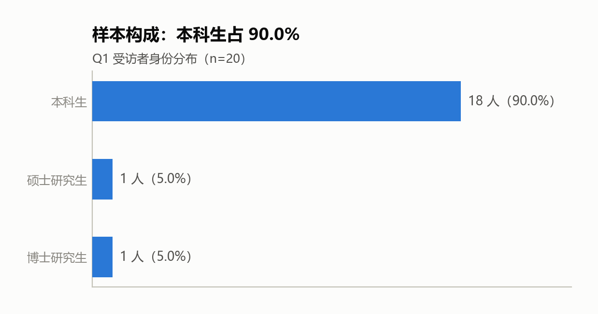
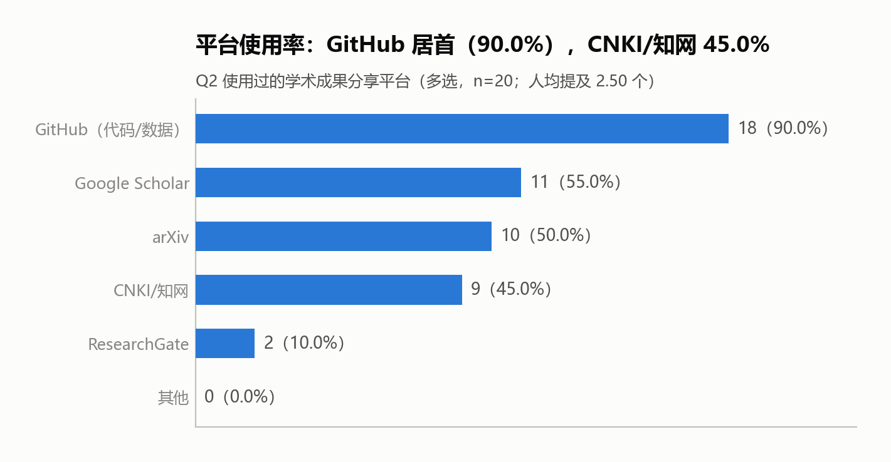
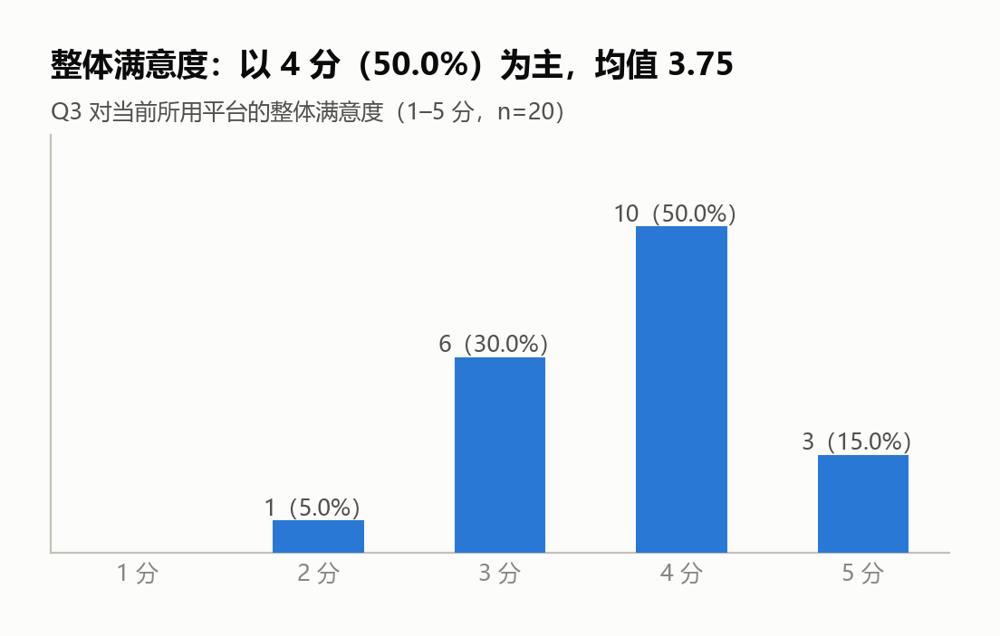
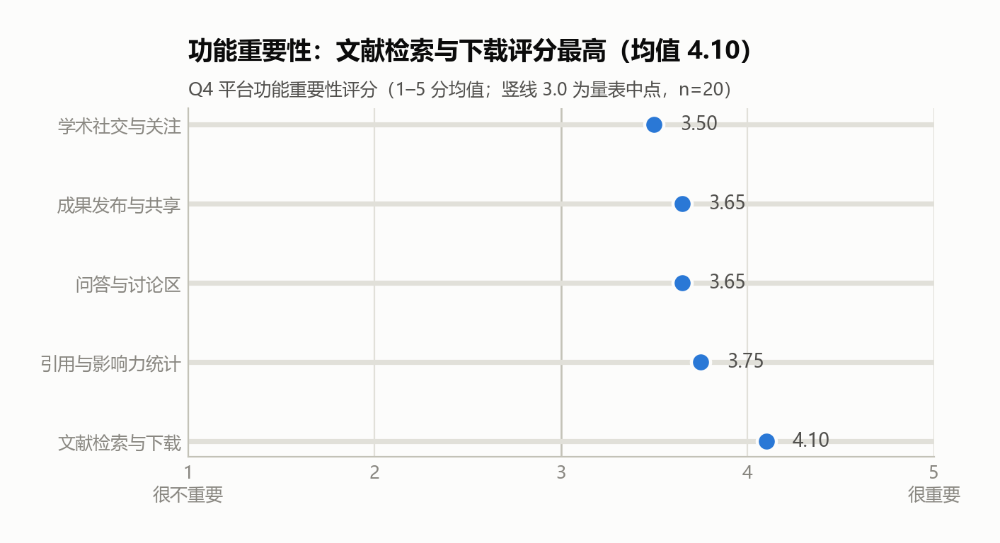
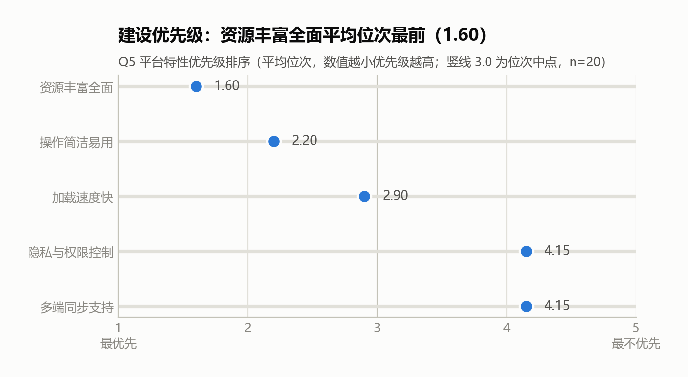
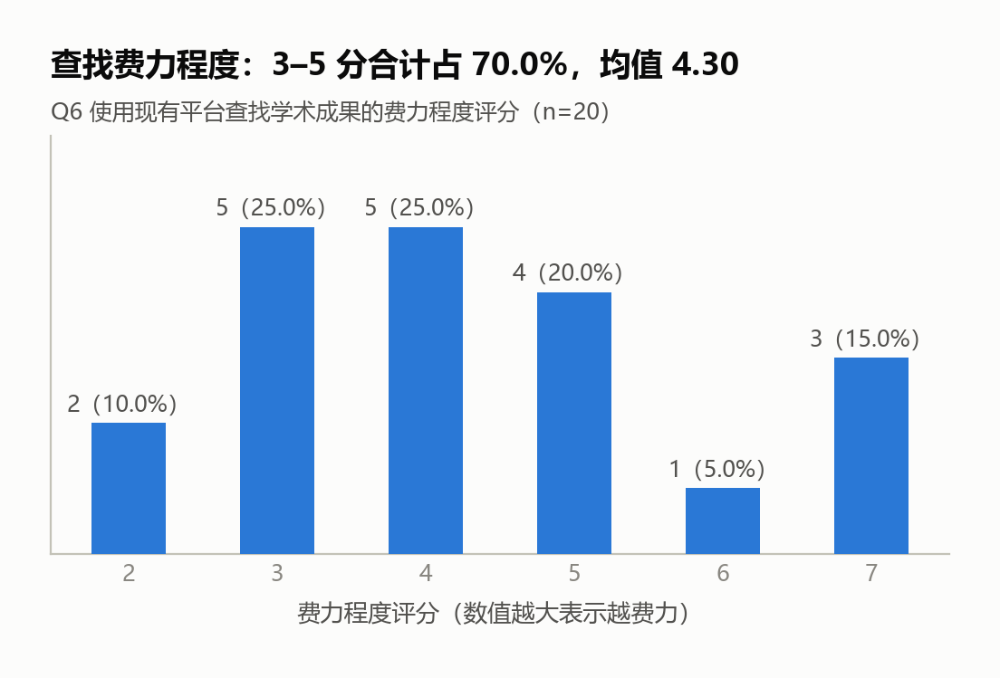

# A1 · 在线问卷调研结果小结

> 选题 1 · 学术成果分享平台 ｜ 作业 1 需求调研
> 数据来源：腾讯问卷导出 `28127809_202610121018367668.csv`
> 图表：[图表/](图表/) ｜ 统计明细：`统计明细.txt` ｜ 复现脚本：`A1-统计分析脚本.py`

---

## 一、调研方法说明

| 项 | 内容 |
| --- | --- |
| 调研工具 | 腾讯问卷（在线问卷） |
| 填写方式 | 匿名收集 |
| 投放渠道 | ⚠️ **待 A1 填写**（本人未掌握实际投放记录） |
| 回收期 | 2026-10-09 12:31 — 2026-10-11 19:14 |
| 回收量 | 20 份，无缺失值，有效 20 份 |
| 题目构成 | 7 题：单选 1、多选 1、评分量表 3 组、排序 1、开放 1 |
| 答题时长 | 21—111 秒，中位数 54 秒 |

本次调研为**在线问卷**，属 A 组"一手证据路线"。问卷面向的干系人为**学生侧**；教师、科研人员、平台管理员侧未被覆盖。

---

## 二、样本构成

| 身份 | 人数 | 占比 |
| --- | --- | --- |
| 本科生 | 18 | 90.0% |
| 硕士研究生 | 1 | 5.0% |
| 博士研究生 | 1 | 5.0% |
| **合计** | **20** | **100.0%** |

**教师 / 科研人员：0 人。**

地域分布（IP 归属地）：北京 18、深圳 1、海口 1。

> ⚠️ 样本高度同质，且全部为在读学生。教师侧与管理员侧在本轮调研中**无任何一手数据**。

---

## 三、逐题结果

### Q2 使用过的学术成果分享平台（多选）

| 平台 | 提及人数 | 提及率 |
| --- | --- | --- |
| GitHub（代码/数据） | 18 | 90.0% |
| Google Scholar | 11 | 55.0% |
| arXiv | 10 | 50.0% |
| CNKI / 知网 | 9 | 45.0% |
| ResearchGate | 2 | 10.0% |
| 其他 | 0 | 0.0% |

人均提及 2.50 个平台。

### Q3 整体满意度（1–5 分）

| 分值 | 人数 | 占比 |
| --- | --- | --- |
| 1 分 | 0 | 0.0% |
| 2 分 | 1 | 5.0% |
| 3 分 | 6 | 30.0% |
| 4 分 | 10 | 50.0% |
| 5 分 | 3 | 15.0% |

均值 **3.75**。

### Q4 平台功能重要性评分（1–5 分均值，5 = 很重要）

| 功能 | 均值 | 评分分布（1/2/3/4/5） |
| --- | --- | --- |
| 文献检索与下载 | **4.10** | 1 / 1 / 2 / 7 / 9 |
| 引用与影响力统计 | 3.75 | 1 / 1 / 4 / 10 / 4 |
| 成果发布与共享 | 3.65 | 1 / 0 / 7 / 9 / 3 |
| 问答与讨论区 | 3.65 | 0 / 2 / 5 / 11 / 2 |
| 学术社交与关注 | 3.50 | 1 / 1 / 6 / 11 / 1 |

五项极差 **0.60 分**，全部高于量表中点 3.0。

### Q5 平台特性优先级排序（平均位次，1 = 最优先）

| 特性 | 平均位次 | 位次分布（1/2/3/4/5） |
| --- | --- | --- |
| 资源丰富全面 | **1.60** | 12 / 4 / 4 / 0 / 0 |
| 操作简洁易用 | 2.20 | 5 / 8 / 5 / 2 / 0 |
| 加载速度快 | 2.90 | 1 / 6 / 8 / 4 / 1 |
| 隐私与权限控制 | 4.15 | 0 / 1 / 3 / 8 / 8 |
| 多端同步支持 | 4.15 | 2 / 1 / 0 / 6 / 11 |

20 份作答均为 1–5 的合法排列，无排序冲突。

### Q6 使用现有平台查找学术成果的费力程度

| 分值 | 人数 | 占比 |
| --- | --- | --- |
| 2 | 2 | 10.0% |
| 3 | 5 | 25.0% |
| 4 | 5 | 25.0% |
| 5 | 4 | 20.0% |
| 6 | 1 | 5.0% |
| 7 | 3 | 15.0% |

实测取值区间 **2—7**，均值 **4.30**，3—5 分合计 70.0%，5 分及以上 40.0%。

> ⚠️ 实际出现的取值上限为 7 且未出现 1，**量表端点须核对原始题目设置**（见"六、局限性"第 5 条）；在端点确认前，本题均值只能作相对比较，不能解释为绝对水平。

### Q7 开放性建议

20 份中 6 份作答，其中 3 份内容为"无"，**有效建议 3 条**：

- 感觉很需要根据我的研究方向智能推荐领域新论文和经典论文
- 相关成果的联合检索？
- 易上手

---

## 四、关键洞察

### 洞察 1 ｜ 学生侧使用习惯偏国际化平台，但校内渠道状况本问卷无法回答

学生侧日常使用的平台以国际平台为主：GitHub 90.0%、Google Scholar 55.0%、arXiv 50.0%、ResearchGate 10.0%；国内平台 CNKI/知网以 45.0% 位列第四。

**⚠️ 必须同时声明的方法限制**：本题**选项集未包含"学院官网""课题组主页""科研管理系统""公众号"等校内渠道**。因此本问卷**既不能支持、也不能否定**"校内渠道利用率低"这一判断，**不得用于印证 B 组的替代渠道普查结论**。该判断只能由 B2 的桌面研究独立得出。

本条可用于需求论证的部分是：新平台若定位为"院内成果陈列"，需评估其与学生既有平台习惯的衔接成本，此项列入需求澄清清单。

### 洞察 2 ｜ 需求重心在"找得到、下得着"，社交属性排序最末，但不宜据此做功能取舍

Q4 与 Q5 指向一致：**文献检索与下载**重要性最高（4.10），**资源丰富全面**优先级最前（1.60）；而**学术社交与关注**重要性最低（3.50），**多端同步支持**与**隐私与权限控制**优先级并列末位（4.15）。

**⚠️ 解释限制**：Q4 五项均值极差仅 0.60 分，且**五项全部高于量表中点 3.0**（最低的学术社交与关注亦达 3.50）。这符合量表题常见的正向默认倾向，说明受试者对各类功能普遍持肯定态度。因此本结果**只能作为功能优先级的参考排序，不能作为"某功能不重要、可以砍掉"的依据**。

### 洞察 3 ｜ ⭐ "隐私与权限"的低排序与"署名可信"的高在意度之间存在张力

Q5 显示受访者把"隐私与权限控制"排在末位（平均位次 4.15，并列最末）。但本项目其他证据路径指出：**成果归属与署名不可篡改是教师侧（成果拥有者）的核心诉求**，未发表成果的可见范围亦属关键约束。

二者并不矛盾，而是揭示了**受访者身份与需求视角的不匹配**：本次受访者 90.0% 为本科生，他们是成果的**读者**而非**所有者**，因此对权限控制不敏感。这正是课件 p.34 所指"用户说的 ≠ 用户要的"——**该冲突不能按问卷多数意见处置，必须由人在需求阶段裁定**。

建议列入 §3.4 需求澄清清单（示例条目）：

> 权限与可见范围的规则，应依据成果所有者的诉求（署名可溯、未发表内容可控）还是读者侧的便利诉求（开放检索）来确定？**本轮问卷结果不支持按读者侧意见裁决。**

**本条是本问卷最具分析价值的产出：它产出的不是答案，而是一个必须提问的问题。**

### 补充观察（探索性，不作结论）

按"是否使用 CNKI/知网"分组：使用者（n=9）在"文献检索与下载"上的评分均值 4.67，非使用者（n=11）为 3.64；Welch t = 2.44，df ≈ 13.5（α = 0.05 双侧临界值约 2.16）。

**⚠️ 该比较为事后探索**：共进行 6 项分组检验、未作多重比较校正、各组样本量极小，属小样本下的预期波动范围。**不作为结论**，仅列为后续验证方向。

---

## 五、达标判定与证据等级

判定规则（见 [作业1-2-合并执行方案.md](../作业1-2-合并执行方案.md) §2.2）：

> n ≥ 30 且非组员占多数 → 升为 **E1 · 证据**；否则降为 **E2 · 假设**。

| 判据 | 实测值 | 是否达标 |
| --- | --- | --- |
| 有效样本量 n ≥ 30 | **n = 20** | ❌ 未达标 |
| 非组员占多数 | 待 A1 核对组员提交份数 | — |

### 判定结论

**本问卷结果为 E2 · 假设，不得写入报告 §3.3「现状调研」，须写入 §3.4「需求澄清清单」并标注 ⚠️。**

在报告中引用时必须：
1. 明示"在线问卷（n=20，学生样本，未达 E1 门槛）"；
2. 不得表述为"调研显示用户如何如何"；
3. 不得与本项目的走查记录、桌面研究结果**合并成一个 n**。

### 敏感性检验

剔除 5 份疑似直线作答（见下节）后 n = 15，各功能排序方向**不变**（文献检索与下载 4.13 仍居首，其次引用与影响力统计 3.67）。判定结论不变。

---

## 六、数据质量清洗记录

| 检查项 | 结果 | 处理 |
| --- | --- | --- |
| 缺失值 | 0 份 | 无需处理 |
| 答题时长 | 21—111 秒，中位数 54 秒；2 份 < 30 秒 | 保留并披露 |
| 疑似直线作答（Q4 五项评分完全相同） | **5 份（25.0%）**：编号 1、11、14、17、18 | 保留全量为主口径，正文披露 |
| 排序题合法性 | 20 份均为 1–5 合法排列 | 无需处理 |
| 地域异常 | 2 份非北京（深圳、海口） | 无法核验，列入局限性 |

> **清洗口径决定**：以全量 **n = 20** 为主口径，同时披露剔除后的 n = 15。理由：① 剔除 25% 将使本已不足的样本进一步失稳；② 两种口径下结论方向一致，主口径取全量更保守。
> 本决定属**人工判断**，不得由 AI 代作。实际执行人：\_\_\_\_\_\_

### 局限性清单（须如实写入报告"局限与后续验证计划"一节）

1. **样本量不足**：n = 20，未达 E1 门槛，全部结果仅为假设；
2. **样本构成单一**：本科生占 90.0%，**无教师 / 科研人员 / 管理员**，教师侧与管理员侧仍无一手证据；
3. **选项集未覆盖校内渠道**：Q2 不能用于判断学院官网、课题组主页等渠道的实际使用情况；
4. **无法核验受访者身份**：问卷未设身份筛选题，2 份答卷来自北京以外地区，无法确认是否为本校成员；
5. **Q6 量表端点不明**：实测取值 2—7 且未出现 1，须核对原始题目刻度后方可解释均值；
6. **开放题有效率低**：20 份中仅 3 条有效建议（15.0%）；
7. **存在 25.0% 的疑似直线作答**。

---

## 七、待 A1 补充确认

| # | 事项 | 影响 |
| --- | --- | --- |
| 1 | **投放渠道记录**（发到哪些群、由谁转发） | 方法说明必填项 |
| 2 | **Q6、Q3 原始量表刻度** | 决定均值可否解释 |
| 3 | **10 名组员提交的份数**（编号 1—20 中哪几份为组员） | 决定 E1/E2 判定的第二项判据 |
| 4 | 图表是否需转为 PDF/EMF 矢量格式插入终版文档 | 排版 |
| 5 | 直线作答 5 份的取舍是否有异议 | 数据口径 |
